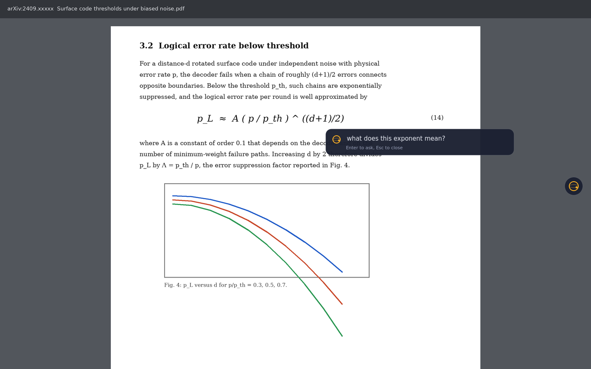
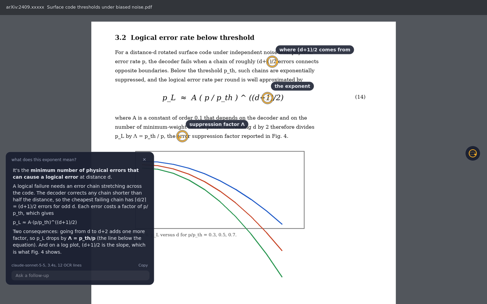

# Marginalia

A study companion that floats over your screen. Press a shortcut (or click the orb), ask about
whatever you're reading or watching, and it answers in a small bubble while amber markers fly to
the parts of the screen it's talking about.




## Install it

No terminal needed: download the latest release from the
[Releases page](https://github.com/amoghdprasanna/marginalia/releases). To try the newest
changes before they're released, take the files from
[Latest build from main](https://github.com/amoghdprasanna/marginalia/releases/tag/latest-main)
instead: it's rebuilt on every change, and the app won't update itself to it.

- **macOS** (Apple silicon): open `Marginalia-<version>-macos.dmg` and drag Marginalia into
  Applications, then open it from there. Until builds are signed with a Developer ID, macOS
  stops the first launch: go to System Settings → Privacy & Security and click **Open Anyway**.
- **Windows:** run `Marginalia-<version>-windows-setup.exe`. It installs for you only, so it
  needs no administrator password, and adds Marginalia to the Start menu. Until the installer
  is signed (see [Code signing policy](#code-signing-policy)), SmartScreen may warn: click
  **More info → Run anyway**.
- **Linux** (Ubuntu 22.04 or newer, Debian 12, 64-bit Intel/AMD): double-click
  `marginalia_<version>_amd64.deb`. It opens in the Software app; click **Install**. Marginalia
  is then in your applications menu.
- **The notebook extension** (Chrome, Edge, Brave): download `Marginalia-<version>-chrome-extension.zip`
  from the same release and unzip it. In `chrome://extensions`, turn on **Developer mode**, click
  **Load unpacked** and choose the unzipped folder. The app connects the extension to Claude by
  itself; open Marginalia once if you installed it from the disk image.

To start it with your computer, tick **Open Marginalia when you log in** in Settings (right-click
the orb). When a new version is out, Marginalia says so and **Update now** downloads it, checks
it against the checksum GitHub recorded for it, and restarts into it (ADR 0028).

## Run from source

```bash
python -m venv .venv
source .venv/bin/activate            # Windows: .venv\Scripts\activate
pip install -e .                     # the core app
pip install -e ".[ocr,voice]"        # optional: sharper pointing, ask by voice
pip install -e ".[openai,gemini]"    # optional: ask OpenAI's or Google's models instead of Claude

marginalia --demo                    # try the interface with canned answers, no key needed
marginalia                           # the real thing (also: python -m marginalia)
```

On first launch a **setup check** lists what Marginalia needs (API key, Screen Recording,
microphone) with a button to fix each. Paste your API key in **Settings**; it is kept in your
system keychain, not in a file. (An `ANTHROPIC_API_KEY` in the environment or a `.env` file
still works and takes precedence; see `.env.example`.)

**Claude, OpenAI or Gemini.** Settings → *Service* picks who answers; each has its own key
(`ANTHROPIC_API_KEY`, `OPENAI_API_KEY`, `GEMINI_API_KEY`), and switching keeps the others.
Get a key from [console.anthropic.com](https://console.anthropic.com/settings/keys),
[platform.openai.com](https://platform.openai.com/api-keys) or
[Google AI Studio](https://aistudio.google.com/apikey). A ChatGPT subscription doesn't include
API access; the OpenAI key is billed separately. Claude is the default and the most tested;
pointing accuracy on the others isn't measured yet (see ADR 0027).

## Use it

- **Ctrl+Alt+Space** (Ctrl+Option+Space on a Mac) asks about exactly where your mouse is. Type
  the question, press Enter.
- **Hold Ctrl+Alt+V** and speak; let go to ask. A quick tap listens until you pause instead.
- **The orb** (right edge of the screen) asks about wherever your mouse last rested. Click it and
  pick **Type** or **Speak**. Speaking ends on a short pause (or Enter/click); Esc cancels.
  Drag the orb anywhere. Right-click it for the **Journal**, **Settings**, the **Setup check**
  and Quit.
- **Follow-ups** in the bubble re-capture the screen first, so they work while a lecture plays.
- **The answer streams in** as it is written; the markers fly once it is complete.
- **Esc or the close button** ends the thread, clears the markers and stops an answer mid-stream.
- Every question, answer and screenshot is saved to `~/Marginalia/doubts/<date>.md`. The
  **Journal** window searches them, shows each thread with its screenshot and markers, and takes
  follow-ups about that saved screenshot. **Copy** (Ctrl/Cmd+Shift+C) puts a thread on the
  clipboard as Markdown, ready for your own notes.
- **Settings** covers model, effort, shortcuts (click a field and press the keys), voice, OCR
  and the journal folder. Changes apply at once. A field set by an environment variable is
  locked and says which one.

## Platform notes

| | |
|---|---|
| **macOS** | The setup check asks for *Screen Recording* and (for voice) *Microphone*. Run from a terminal, macOS asks about the terminal app, and it must be restarted after you allow Screen Recording. Shortcuts need no Accessibility permission (they use the system hotkey API). |
| **Windows** | Works as is. If your antivirus flags the keyboard hook, use `--no-hotkey`. |
| **Linux** | X11 works fully. On **Wayland**, screenshots and shortcuts go through the desktop portal (shortcuts need KDE Plasma, GNOME 48+ or another desktop with the GlobalShortcuts portal; the desktop may ask you to confirm the keys), and windows run through XWayland. The mouse position is only approximate there, so prefer clicking the orb after pointing. |

## How it works

```
shortcut / orb
   -> hide own windows, grab the screen under the cursor (Qt)
   -> OCR starts in the background while you type
   -> two images: full screen + close-up around the cursor (red ring marks the cursor)
      resized exactly the way the API resizes, so returned coordinates line up 1:1
   -> model replies in a schema-checked JSON envelope: answer + up to 4 points
      (pixel coords, optional OCR line id); the answer is decoded and shown while it streams
   -> points snap onto OCR lines when the two agree, then map back to screen coordinates
   -> overlay animates markers; bubble picks a spot that covers neither cursor nor targets
```

| File | Job |
|---|---|
| `src/marginalia/capture.py` | Screen grab, HiDPI mapping, image resizing, cursor ring |
| `src/marginalia/ocr.py` | Optional OCR text lines with boxes (Apple Vision on macOS, RapidOCR elsewhere) |
| `src/marginalia/brain/` | Prompt, API call, reply parsing, demo mode |
| `src/marginalia/pointing.py` | Point resolution and snapping, bubble placement |
| `src/marginalia/ui/` | Orb, chooser, ask and listen boxes, bubble, pointer overlay; Settings, Setup and Journal windows |
| `src/marginalia/voice.py` | Optional mic recording and local Whisper transcription |
| `src/marginalia/cursor.py` | Where the mouse last rested (what the orb asks about) |
| `src/marginalia/config.py` | Settings: defaults, settings file, environment, command line |
| `src/marginalia/providers.py` | The model services: names, key locations, models |
| `src/marginalia/secrets.py` | API keys in the system keychain |
| `src/marginalia/hotkeys.py` | Global shortcuts with press and release (Carbon on macOS, pynput elsewhere) |
| `src/marginalia/permissions.py` | The setup check: what the system allows, and how to fix it |
| `src/marginalia/journal.py` | Reading the journal back: threads, search, reopening a screenshot |
| `src/marginalia/logs.py` | Console lines and a JSON-lines log file |
| `src/marginalia/app.py` | Wiring, injectable services, threads, follow-ups, live settings changes |
| `eval/run_eval.py` | Accuracy harness: pointing hit rate and answer checks |

## Measure quality, speed and cost

```bash
python eval/run_eval.py                     # every case in eval/cases, configured model and effort
python eval/run_eval.py --effort low        # compare settings: --model, --effort, --repeat N
python eval/run_eval.py --no-ocr            # compare with OCR off
```

Each run prints pointing hit rates, the must-mention rate, time to first words, total time and
cost per question, and saves details to `eval/results/`. It makes real API calls.

To grow the case set, run the app with `MARGINALIA_SAVE_CASES=1`. Each question is saved to
`~/Marginalia/cases/` with its raw screenshot and a `case.json` that already has the question,
cursor and where the model pointed; fill in `targets` and `must_mention`, then copy the folder
into `eval/cases/`. Aim for 30+ real cases before changing prompts or models.

## Develop

```bash
pip install -e ".[ocr,voice,dev]"
pytest                               # ~370 tests, offscreen, no network, mic, keychain or hotkeys
pytest -m unit                       # just the pure-logic tests (a few seconds)
pytest -m "ui or integration"        # widgets, and the controller end to end
pytest --cov=marginalia              # with coverage
ruff check .                         # lint
```

- **Design:** [`docs/design.md`](docs/design.md) lists the interface principles every UI change
  is checked against.
- **Architecture:** [`docs/architecture.md`](docs/architecture.md) explains the layers, the three
  coordinate spaces and the threading rules. Each design choice has a short record in
  [`docs/adr/`](docs/adr/) with the alternatives that were turned down.
- **Workflow:** branch from `main`, keep commits small, open a PR; CI runs lint and tests on
  Linux and macOS. A change to a dependency, data flow or module boundary gets a new ADR.
- **Tests:** `tests/unit/` for logic in plain modules, `tests/ui/` for one widget at a time
  (pytest-qt), `tests/integration/` for whole flows through the controller (ask, voice,
  streaming, startup). The folder sets the marker. Slow or external things are injected through
  `app.Services` and replaced by the fakes in `tests/helpers.py`. Test names state the behaviour
  ("a failing OCR does not cost the answer"). A bug fix starts with a failing test that names the bug.
- **Plan:** [`ROADMAP.md`](ROADMAP.md). **Changes:** [`CHANGELOG.md`](CHANGELOG.md); add a line
  under Unreleased with every user-visible change.
- **Releases and the app:** `pip install -e ".[package]"` then `python packaging/build.py` builds
  `dist/Marginalia.app` and a `.dmg` (Windows: a setup `.exe`, with Inno Setup installed). Releasing is `scripts/release.py` plus a
  tag; see [`docs/releasing.md`](docs/releasing.md), including signing and notarisation.
- **Logs and crashes:** `<log dir>/logs/marginalia.jsonl` (JSON lines; metrics, never your
  questions) and `<log dir>/crashes/`.

## Privacy

Nothing from your screen leaves your computer until you ask a question. What is sent, and when:

- **When you ask a question:** the screenshot of the screen you're on, a zoomed crop around the
  pointer, the text OCR read from it, your question and the earlier turns of that conversation
  go to the model provider you picked in Settings (Anthropic, OpenAI or Google), using your own
  API key. The notebook extension sends the cells and error you ask about the same way. That
  provider's privacy policy covers what happens next.
- **Once a day, if "Check for new versions" is on** (Settings): a request to the GitHub API for
  the latest release. It carries no information about you beyond what any web request does.
- **The first time you ask by voice:** the speech model downloads from Hugging Face. Your voice
  is transcribed on your computer and never uploaded; only the transcribed question is sent, as
  above.
- **Crash reports are off by default.** If you turn them on, Marginalia offers to open a GitHub
  issue in your browser with the error and recent log lines (never your questions or answers),
  which you read and edit before deciding to send it.

Your API key stays in your system keychain. The journal of questions and answers, its
screenshots and the logs stay on your computer.

## Code signing policy

Windows releases are to be signed with free code signing provided by
[SignPath.io](https://about.signpath.io/), certificate by
[SignPath Foundation](https://signpath.org/) (application pending; until then the installer is
unsigned). Only files built by this repository's
[release workflow](.github/workflows/release.yml) on GitHub Actions, from a tagged commit, are
submitted for signing.

- **Committers and reviewers:** [Amogh D. Prasanna](https://github.com/amoghdprasanna)
- **Approvers** (who approve each signing request): [Amogh D. Prasanna](https://github.com/amoghdprasanna)

Every change reaches `main` through a pull request that CI tests. See [Privacy](#privacy) for what
the app sends over the network.

## License

[MIT](LICENSE). The notebook extension in [`extension/`](extension/) is MIT too.
